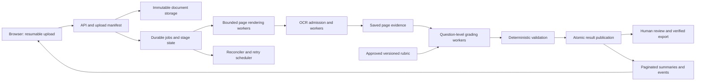

# Reliability and scaling audit — 21 October 2026

> Historical assessment before the implementation in this working tree. See `../RELIABILITY_DEPLOYMENT.md` for implemented changes, current checks, and remaining validation. `probe_results.json` records the original failures; it is not a current test report.

## Assessment

The current application has useful reliability foundations, but it is not yet demonstrated safe for unattended processing of thousands of answer sheets. The recurring problems arise from several architectural gaps: whole-exam model calls, incomplete automatic recovery, non-atomic result publication, unbounded list responses, and deployment drift. Increasing timeouts or parallelism alone will not resolve these problems.

The realistic objective is durable acceptance, automatic recovery from transient failures, bounded resource use, and explicit human review for genuinely ambiguous material. No system can guarantee that a model, GPU, network or document never fails. It can guarantee that a failure does not silently lose work, fabricate marks, publish an obsolete result, or stop unrelated sheets indefinitely.

This audit changes no production behavior. It adds this report and offline reproduction probes. Earlier changes to truncation handling and the results view remain in place and were included in the review.

## Scope and evidence

Reviewed the active root backend, worker, workspace persistence, inference gate, PDF/OCR implementation, model client, validation, authorization, upload/export APIs, frontend routes and polling, legacy processing paths, Dockerfile, systemd example, CI configuration and relevant tests. The nested `AI_Evaluater_Development` checkout was identified as a second source tree, not treated as the production source of truth or exhaustively audited.

Executed:

- 84 existing backend tests across workspace, API, reliability, discovery, security, multiuser, worker and inference gate suites: passed.
- All 17 frontend tests in four suites: passed. React test-act and router deprecation warnings remain.
- Isolated audit probes using fake documents, mongomock and mocked inference: confirmed the eight observations below.

No production GPU, live MongoDB, reverse proxy, actual model tokenization, real OCR accuracy, container startup or sustained load test was exercised. Mongo mocks do not establish database failover or distributed concurrency correctness. Passing existing tests does not certify scalability.

Reproduce with backend dependencies and `backend/requirements-test.txt` installed: `python audit/reliability_probes.py`. Results are also saved in `audit/probe_results.json`.

| Probe | Observed result |
|---|---|
| 500 files, one path field per file | HTTP 200 in isolated Flask parser |
| 501 files with the same format | HTTP 413 before application validation |
| Invented question ID, valid arithmetic | Accepted as completed |
| `require_json=True` inference request | No schema constraint sent |
| Question paper modified after preparation | Both test sheets completed |
| Two students sharing an answer key | Key extracted twice |
| Snapshot of two sheets | Five collection read calls |
| Lease changes immediately before result save | Old worker still activates result |

## Priority findings

Priority P1 means fix before scaling unattended operation; P2 means important reliability, efficiency or maintenance work. Static findings indicate a code path or risk, not an observed production incident.

### P1 — Result publication is not protected through the final commit

Evidence: `backend/utils/workspace.py:222`, `:294`, `:295`, `:303`, `:305`.

The worker checks its lease inside `stage('saving')`, then writes the attempt, active-result pointer and job separately. The attempt completion filter checks status but not a fencing generation. The sheet update checks configuration and pinning, but not worker ownership. The final job update does not include attempt ID or processing state. The probe changes lease ownership between the check and the save and the stale worker still publishes.

There is startup reconciliation for a crash after saving a completed attempt, which is valuable, but it does not make these writes atomic. A cancellation arriving after the last stage check also has no clearly enforced commit boundary. Missing global lease records are accepted by the stage check (`if lease and ...`).

Fix: make publication a versioned compare-and-set on a single authoritative job/sheet record, or a transaction with appropriate concurrency checks on a replica set. Every claim receives a monotonically increasing generation. Every stage/result publication must match that generation, attempt ID, expected state and input revision. A lease renewal/read alone is insufficient. Declare when cancellation is too late. Keep immutable result records and a reconciliation process for materialized views. MongoDB documents that separate document writes can interleave; transactions require a supported deployment. [MongoDB atomicity](https://www.mongodb.com/docs/manual/core/write-operations-atomicity/).

### P1 — A transient worker/storage failure can stop the queue

Evidence: `backend/worker.py:27`, `:53`, `:75`, `:96`; `backend/utils/workspace.py:195`, `:220`, `:309`; systemd service example.

Any heartbeat exception sets the stop flag. A failure escaping a job future stops the coordinator. The initial attempt write is outside the process exception handler, and error-recording database operations can also fail. The embedded worker logs that a backend restart is required and does not restart itself. Recovery marks incomplete attempts as errors requiring manual retry; saved page OCR helps only after retry is requested.

The standalone example uses `Restart=on-failure`. A heartbeat-driven stop can return normally, so that policy does not necessarily relaunch the worker. A second waiting process may take over, but one is not guaranteed by the supplied deployment.

Fix: supervise the worker independently of HTTP processes; re-acquire ownership with backoff; distinguish shutdown, lost ownership and transient dependency outage. Store retry count, next eligible time, error class and stage. Automatically resume eligible interrupted jobs using checkpoints. Give permanent document/rubric failures a human-review state. Isolate one job failure from the queue coordinator. Use a watchdog/reconciler while the system is running, not only on startup.

### P1 — Whole-exam grading remains larger than the model contract

Evidence: `backend/utils/gemini_service.py:28`, `:75`, `:92`, `:140`, `:184`; `backend/utils/workspace.py:286`.

All answer-key text, student text and question-paper text are put into one grading prompt. Exact preflight is optional and is applied only to JSON grading, not image OCR. Increasing the response budget consumes the same finite context window as input. The preceding fix adds bounded output retries, but cannot make an overlong input fit and cannot guarantee completion for a 34-page exam.

`require_json=True` does not request schema-constrained output; it only enables optional token preflight. Invalid JSON/schema output is not given a separate recovery policy. A model `needs_review` result becomes a generic failure, encouraging repeated evaluation of missing rubric information. Nested transport retries can restart the output-budget sequence; there is no persisted overall work deadline.

Fix: prepare and approve a versioned structured rubric once per exam; map student evidence to explicit question IDs; grade bounded questions or rubric-defined groups; validate and total deterministically. Preserve optional-question and cross-question rules. Never split arbitrary page/token chunks and sum their marks. Reject unknown/duplicate/missing question IDs and incorrect maxima. Use schema-constrained generation if the installed vLLM version/model supports it, with a bounded repair strategy and human review on exhaustion. [vLLM structured outputs](https://docs.vllm.ai/en/stable/features/structured_outputs/).

### P1 — Validation checks arithmetic, not agreement with the actual rubric

Evidence: `backend/utils/result_validation.py:6`; `backend/utils/verification.py:12`.

Question IDs need only be nonempty unique strings; allocations need only add to the exam maximum. The model can invent a single 100-mark question and pass validation. The isolated probe confirms this. `checked()` reconstructs a minimal result without question scores, so verification does not independently recheck the saved question breakdown. Normal automated grading does require question scores; manual marks need a separate explicit validation contract.

Fix: validator takes a trusted rubric revision, expected question IDs, weights, required responses and choice rules. Preserve evidence page references. Human verification binds to the immutable result revision and the rubric revision. Treat manual adjustments as explicitly attributed overrides, not AI question-level results.

### P1 — Browser progress creates an N+1 database workload

Evidence: `backend/utils/workspace.py:127`; `backend/workspace_api.py:28`; `frontend/src/pages/Workspace.jsx:47`, `:114`.

For N sheets, snapshot issues 1 sheet query + N attempts queries + N job queries, before authorization/lease/access work. It returns every attempt, feedback and up to 100 events per job. The UI fetches this and `/access` again three seconds after each refresh completes. Results-only mode still computes activity data even though it is hidden.

At 5,000 sheets, one refresh issues about 10,001 collection reads. With 20 open clients, the idealized three-second refresh load is approximately 66,673 reads/second if refreshes were instantaneous. Actual request duration reduces that rate, but increases latency and in-flight work. This is an operation-count illustration, not a throughput benchmark.

Fix: paginated compact sheet summaries, server-side course/exam/status filters, separate on-demand details/history endpoints, and aggregate counters. Fetch permissions on login/change rather than every progress refresh. Add an incremental event cursor or authenticated event stream; maintain a polling fallback. Index actual filter/sort combinations and verify query plans. Keep response/query counts bounded as the database grows.

### P1 — The advertised bulk upload size cannot pass the default parser

Evidence: `frontend/src/services/api.js:243`; `backend/app.py:1061`; Flask/Werkzeug configuration.

Each file creates two multipart parts: the file and its path. The application permits 1,000 files but the default parser permits 1,000 parts. A 501-file request therefore exceeds the parser limit. This was reproduced locally. The entire upload is one request, and preparation hashes all files synchronously within a 60-second workspace client timeout. Partial writes can survive a failed request without a clear completed-batch manifest.

Fix: resumable upload sessions, bounded chunks or per-file uploads, checksums, an immutable manifest and idempotent finalization. Queue preparation and expose accepted/rejected file counts. Make client, proxy, parser, file-count and byte limits consistent. Do not solve large-batch reliability solely by increasing one limit. [Flask resource limits](https://flask.palletsprojects.com/en/stable/web-security/).

### P1 — Container packaging and worker startup are incomplete

Evidence: `backend/Dockerfile:40`, `:56`; `backend/app.py:24`, `:1155`, `:1160`; `.github/workflows/docker-image.yml`.

The Dockerfile copies neither `access.py` nor `admin_api.py`, although the app imports both. A clean image built from this file would fail the application import once dependencies install. The default command starts Gunicorn only; the embedded worker starts only under `python app.py`. The worker service example is separate and not installed by this container. The supplied CI does not build/start this image.

Fix: package all required modules; explicitly deploy API and worker services with shared durable document storage; smoke-test both in CI. Readiness must report worker and model capability separately from HTTP/database health. Verify that the actual production deployment matches the audited source and release ID.

### P1 — Prepared question-paper identity is not enforced

Evidence: `backend/utils/workspace.py:73`, `:278`, `:288`.

Preparation hashes the question paper into configuration, but processing rechecks only student and answer-key file hashes. The question paper can change while the stored configuration still describes its previous contents. The probe completed both sheets after such a change; caches/provenance can then disagree with the actual material used.

Fix: validate all source hashes, store immutable content-addressed documents, and use an input revision consistently throughout claim, cache, grade, verification and export.

## Additional important findings

| Priority | Finding and evidence | Recommended correction |
|---|---|---|
| P2 | Shared answer-key and question-paper OCR cache keys include student sheet ID (`workspace.py:236`). Two students caused two key extractions. | Share immutable course/exam document OCR by content hash, extraction version and access scope; deduplicate in-flight preparation. Keep student access and deletion semantics separate. |
| P2 | All PDF pages render into a list at 150 DPI before processing (`pdf_processor.py:49`, `workspace.py:246`). No render timeout is supplied. Cached pages are still rendered on retry. | Check page metadata, render only missing pages in small batches, release images promptly, isolate renderers with memory/time limits. |
| P2 | A4 RGB at 150 DPI is roughly 6.2 MiB/page, about 224 MiB for 36 pages, or 1.1 GiB for five such lists before intermediates/runtime overhead. | Measure peak RSS and bound pixels/pages/bytes per job; concurrency must account for host memory as well as GPU capacity. This is an estimate, not a measurement. |
| P2 | The global worker lease permits only one coordinator; concurrency is hard-capped at five (`worker.py`, `runtime_settings.py`). | Introduce per-task leases before multi-worker scaling. Separate CPU rendering concurrency from GPU admission. Merely adding processes will not scale the current coordinator. |
| P2 | `VLLM_MAX_CONCURRENT_REQUESTS` and `BATCH_PROCESSING_MAX_WORKERS` are validated in Config but active concurrency reads the DB setting/default instead. | One authoritative configuration contract with visible effective values and migration of old settings. |
| P2 | The inference slot has a fixed expiry and no renewal (`inference_gate.py`). Requests read timeout is not a hard total deadline; a timed-out server generation can also continue after the client releases a slot. | Use bounded overall deadlines, renewable admission leases, server cancellation/request IDs where supported, and server-side capacity controls. Monitor orphaned requests. [Requests timeout semantics](https://requests.readthedocs.io/en/latest/user/quickstart/#timeouts). |
| P2 | Inference admission raises built-in `TimeoutError`, while automatic transport retry catches Requests exceptions only. Tokenizer HTTP failures also follow a different path. | Typed retry policy for admission, network, model saturation, tokenization, invalid output, corrupt PDF and insufficient evidence. Add jitter, retry-after and outage circuit breaking. |
| P2 | Preparation checks jobs before updating sheets without an atomic reservation (`workspace.py:78`). Bulk preparation/enqueue/verification are multiple writes. | Protect input revisions with compare-and-set/reservations; return durable per-item outcomes and a batch operation ID after partial failure. Do not imply all-or-nothing success without transactional support. |
| P2 | Management reservations expire after five minutes and are not renewed. Long bulk work can outlive exclusivity (`workspace.py:140`). | Renew and fence reservations, cap transaction scope, make maintenance resumable. Audit writes should not turn a successful mutation into an unexplained retry. |
| P2 | One page with <20 extracted characters forces visual OCR for the whole PDF; pages with a small text layer can pass despite unextracted handwritten content. Blank/unreadable OCR markers are not a robust quality signal. | Per-page extraction classification and evidence quality checks; explicitly distinguish blank, unreadable and failed pages. Verify handwriting/diagrams against a representative gold set. |
| P2 | More than 36 pages is rejected only by the visual conversion path; text PDFs follow different rules. | Validate supported document constraints at acceptance and show permanent input issues before expensive OCR. |
| P2 | Course discovery keeps folder casing but course registration uppercases codes; duplicate question papers overwrite the chosen path, and repeated course folders can be skipped (`course_processor.py`). | Canonicalize identifiers once; fail ambiguous keys/papers/duplicate student IDs; show a manifest for every discovered or rejected input. |
| P2 | Uploads, caches and audit records have no visible retention/quota policy; failed folder uploads can leave orphaned files. | Durable document store, reference-aware cleanup, retention and disk-capacity alerts, backup/restore drills. Never delete source evidence solely because a cache expired. |
| P2 | Local absolute source paths are embedded in jobs. | Shared durable volume for one host initially; storage keys instead of host paths before distributing workers. Back up database and documents consistently. |
| P2 | UI renders all rows, uses array membership for each selection, and sorts all visible events before taking 100 (`Workspace.jsx:104`, `:114`, `:186`). | Pagination/virtualization, Set-based selection, server event limits. Selecting >1,000 visible sheets also conflicts with API operation limits. |
| P2 | Result details expect `feedback/reason/reasoning`, while the prompt only requests an unspecified evidence summary field (`ResultDetails.jsx:24`). | One shared response schema with a named evidence field and source references. Add contract tests from model payload through display/export. |
| P2 | Health endpoint checks only MongoDB. Heartbeat expiry does not prove useful job progress. Shared rotating file logging is instantiated by multiple Gunicorn processes. | Separate liveness, dependency readiness and work-progress metrics; centralize stdout logs, add correlation IDs and operational alerts. |
| P2 | Workspace indexes omit cache-by-sheet deletion and several course/sort access paths. Client filters are not sent to the server. | Add indexes based on paginated API query plans and production-like cardinality; do not blanket-index every field. |

## Loose code, inconsistent contracts and unused connections

- `app.py:899` returns HTTP 410 before a substantial legacy batch-start implementation; that body is unreachable. Legacy batch state, stream/stop helpers, pipeline and old frontend still exist.
- The old EventSource helper puts the token in a URL, while authentication accepts only a bearer header. That helper cannot authenticate against the current route. Do not restore query-string token authentication as a quick fix; migrate/remove the helper.
- `ResultsOverview.jsx` is tested but is not mounted by `App.js`; its tests do not verify the actual `/results` composition. `BatchEvaluate.jsx` similarly retains a disconnected workflow.
- The accessible legacy single-sheet evaluation route still performs model work synchronously within HTTP handling and has separate filesystem caches. Route it through the durable queue or formally deprecate it.
- `EvaluationPipeline` has independent cache/version and resume semantics; its course/roll resume logic lacks the workspace exam/config identity. Do not accidentally re-enable it as a shortcut.
- `PDFProcessor.extract_text_from_images()` calls `get_ocr_reader()`, which is not defined in the active class. It is not the current workspace OCR path, but should be removed or completed before reuse.
- `GeminiService` is actually a vLLM client; `api_keys`, `deepseek_api_key` and `use_pro` no longer choose the backend. Comments still promise Gemini key rotation. Rename the adapter and retire unused provider settings after checking integrations.
- `_connect_mongomock()` remains as an unused fallback helper. The active connection path correctly refuses nonpersistent fallback; remove the misleading helper/docstrings.
- Upload-limit comments contradict active configuration. Deployment documentation describes older single-worker behavior and previous results composition. Update docs with executable smoke checks.
- Duplicate source tree, backup files, generated build artifacts and multiple entry points make deployment provenance unclear. Establish one maintained source tree and an immutable release manifest; do not delete unrelated work without checking ownership.
- Requirements contain provider SDKs and heavy OCR/torch dependencies beyond the active path. Trace actual use before pruning; isolate API, renderer and inference-client dependencies for smaller reproducible images.
- CI runs only selected backend/frontend suites and no real MongoDB/concurrent-failure or image-startup tests. Existing tests cover many basic safety cases, but the probes demonstrate missing invariants.

## Recommended architecture

Keep MongoDB initially; replacing the database or adding a broker is not the first prerequisite. First implement a durable state machine and idempotent stage execution. Split work into independently restartable stages, then scale the bottleneck established by measurements.

Core contracts:

1. **Durable acceptance:** acknowledge acceptance only after source checksums, storage references and batch manifest are durable. An idempotency key makes retrying an upload/finalize/queue operation safe.
2. **Stage identity:** use document hash, page/question ID, rubric revision, model revision, prompt/extraction version and input revision. Model names alone are not immutable versions.
3. **At-least-once execution, idempotent publication:** duplicate execution is possible after network/process failure. Unique result identities and fenced publication prevent duplicate or obsolete active grades.
4. **Explicit state machine:** uploaded → validating → ready → queued → rendering/OCR → grading → validating_result → awaiting_review → verified. Separate retry_wait, needs_input, failed_permanent and cancelled states. Keep execution status distinct from an older active result.
5. **Per-task ownership:** owner, generation, lease expiry, heartbeat, retry count, next_run_at, overall deadline and last checkpoint. Resume completed stages rather than restarting a whole sheet.
6. **Independent capacity:** CPU rendering, OCR inference and grading have separate bounded queues and budgets. Limit queued work admitted to memory. Use per-course fairness so one large course cannot starve the rest.
7. **Rubric preflight:** extract/validate shared marking documents once; require human resolution of missing rules. This prevents thousands of copies of the same predictable grading failure.
8. **Reviewable evidence:** retain source page references, extraction quality, prompt/model versions and validation reasons. Keep marks independent of processing failures.
9. **Operational visibility:** queue depth and oldest age, stage latency p50/p95/p99, retry rate by cause, stale leases, render RSS, model token counts, GPU utilization, cache hit rate, DB latency and accepted-versus-terminal sheet reconciliation.

A broker such as RabbitMQ/Celery can be introduced later for distributed stage delivery if operations can support it. It does not replace durable application state, idempotency, ownership checks or reconciliation. Avoid an unprotected database-write + queue-publish dual write; use an outbox or equivalent recovery mechanism. [Celery task delivery and retry guidance](https://docs.celeryq.dev/en/stable/userguide/tasks.html).

## Capacity planning

Thousands of sheets in a durable queue is different from thousands of simultaneous model calls. Set an explicit completion window and benchmark representative handwriting, page counts and answer-key sizes.

Approximate model work time in seconds:

`T ≈ N × (P × t_ocr + Q × t_grade) / C_effective`

N is sheet count; P is uncached pages per sheet; Q is grading groups; t values are measured service times at the chosen concurrency; C_effective is measured sustained concurrent capacity. Add shared preparation, rendering, retries, validation and other bottlenecks. Token throughput and batching can make the simple formula inaccurate, so use it for planning, not a promise.

Illustration only: 5,000 sheets × 20 uncached pages × 10 seconds/page = 1,000,000 OCR service-seconds. At three effective concurrent requests that is about 92.6 hours; at five, 55.6 hours, before grading. For 34 pages, the five-request illustration is about 94.4 hours. Increasing configured concurrency may increase request latency and GPU memory pressure instead of increasing useful throughput.

Measure a representative 100–200-sheet sample first. Record text-only versus image pages, tokens, latency, memory, quality failures and retry amplification. Benchmark 1/2/3/5 concurrent model calls. Choose capacity below the sustained saturation point, then estimate hardware needs from the required completion window.

## Implementation order and release gates

### Phase 1: close correctness and deployment gaps

Fix Docker imports/startup, question-paper identity, stale-worker publication and cancellation boundaries. Add canonical question/rubric validation. Make worker restart/recovery automatic and define retryable errors. Align upload limits immediately while building chunked upload. Keep existing validated results intact.

Exit gate: isolated reproduction cases become regression tests with corrected expectations; clean container starts API and worker; killing a worker or briefly losing MongoDB does not require manual intervention for transient jobs; obsolete workers cannot activate results.

### Phase 2: bound resource use and reduce repeated work

Paginate summaries and fetch detail/history on demand. Add resumable uploads/asynchronous preparation, streamed page rendering, shared rubric/key OCR, per-page quality states and typed stage retries. Remove obsolete routes/helpers only after checking consumers. Expose effective configuration and release IDs.

Exit gate: large lists no longer cause per-sheet database round trips; retry reuses saved pages; shared answer key is processed once per version; oversized/corrupt inputs are classified before expensive work; resource consumption stays within configured bounds.

### Phase 3: bounded grading and horizontal worker design

Introduce structured rubrics and question-group grading, deterministic aggregation, generation-fenced stage claims and per-resource admission. Move source references to shared storage keys. Add a broker only if the measured deployment needs it.

Exit gate: optional-question rules and cross-page answers match a reviewed gold set; stage duplicates cannot create multiple active outcomes; multiple workers safely share a queue; fair scheduling and backpressure hold under saturation.

### Phase 4: prove reliability under failure and load

Use a real test MongoDB topology, test model server and production-like object storage. Run 1,000 then 5,000 synthetic jobs with representative page/attempt/event distributions and concurrent browsers. Run a smaller real-model corpus plus a 24–48-hour soak. Inject worker kills during OCR/save, database outage and recovery, model timeout/429/500/truncation, slow responses, expired leases, upload disconnect, duplicate submissions, disk-full, corrupt/blank/mixed PDFs, and cancellation races.

Proposed acceptance criteria (targets, not current measurements):

- Zero lost acknowledged sheets; every manifest entry reconciles to a durable state.
- Zero stale-owner result publications, duplicate active results, or processing failures recorded as academic zero.
- No silent omitted pages or invented rubric IDs accepted as valid.
- Recovery resumes from the last successful stage within a defined lease/backoff budget, for example two minutes after dependencies recover.
- Invalid inputs reach an actionable review state without endlessly retrying or blocking other courses.
- Paginated list p95 under one second at 5,000 sheets and 20 viewers in the agreed test environment; query counts bounded by page size, not total sheets/history.
- Stable memory during sustained load; rendering and inference stay within measured resource limits.
- Restore drill reconstructs documents, attempts, active selections and verification history consistently.

Choose the recovery and throughput targets after measuring the actual DGX, model/version, GPU allocation, database topology and document distribution. These facts are not established by this repository audit.

## Preserve the existing good safeguards

Do not discard stable sheet identity, atomic duplicate-job insertion, immutable attempt history, valid-zero preservation, input/prompt cache versioning, per-page OCR checkpoints, authorization checks, explicit destructive-action confirmation, verified-only exports or crash reconciliation. Extend and test these foundations. The safest path is a sequence of measurable changes, not an untested full rewrite.
