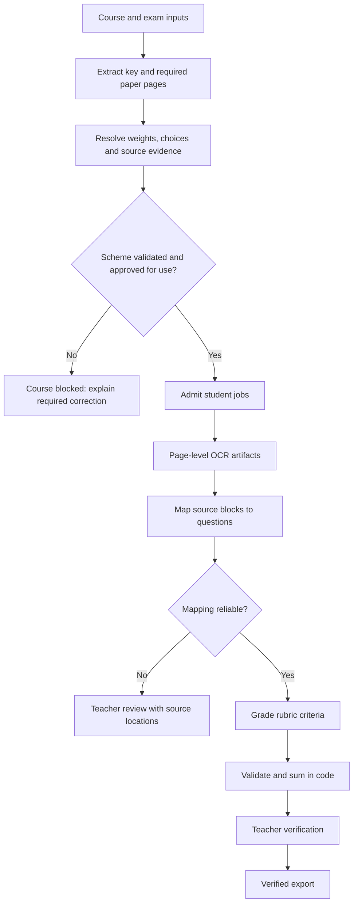

# Production readiness audit and stabilization plan

Date: 23 October 2026. Scope: the main `backend/` and `frontend/` implementation,
deployment examples, supplied DGX logs, and current primary-source documentation.
Git HEAD at inspection: `ea88e8ba`, plus existing working-tree changes. The recently
added preflight and progress changes are local; their presence on DGX has not been
verified. No application logic or production services were changed for this audit.

**Decision:** the system has useful persistence and review safeguards, but is not
ready for unattended academic grading. Long opaque runs, unlimited infrastructure
retries, and demonstrable validation gaps require a stabilization release and a
teacher-scored pilot. Passing mocked tests is not an accuracy certificate.

**What the evidence establishes**

The supplied production logs show OCR progressing through a 34-page paper, with
many successful requests taking about 24–48 seconds. Several other requests took
about 410 seconds and were truncated, then restarted with a larger generation
budget. Three requests had equal payload sizes and nearly identical timing. That
suggests duplicate work but does not prove identical contents; the older logs lack
request-to-sheet correlation. The observed 96% GPU utilization establishes that
the GPU was busy at that instant. It does not identify which request advanced or
separate queueing from generation. Those requests used localhost, so the mobile
hotspot was not transporting their image bodies to vLLM.

The reviewed working tree now contains course-first marking preparation,
in-flight request coalescing, and richer progress. Those are improvements, not
evidence that the deployed system has changed or that accuracy is established.

**Confirmed findings, ordered by release importance**

| Priority | Finding and evidence | Consequence | Required correction |
|---|---|---|---|
| P0 | `structured_grading.py:29` checks source-quote presence, question ID and totals, but not that the extracted numeric allocation is supported by the quoted field. A synthetic `Q1 5 marks` source was accepted with `max_marks=10`. | A structurally valid rubric can have wrong weights. | Bind allocations to source page/region/span and validate the question-to-number relationship. Ambiguous tables, arithmetic and choice rules require explicit review. |
| P0 | `structured_grading.py:222` asks for question IDs and short source quotes, then verifies preservation of text. It does not independently establish semantic question assignment. The offline probe assigns text containing both Q1 and Q2 entirely to Q1, and the pipeline accepts Q2 as unanswered with zero. | Text preservation can coexist with an incorrect mapping and an incorrect zero. | Map stable OCR blocks/line spans using question headers, complete question context, layout and continuation evidence. Require a confirmed unanswered state before awarding zero for no mapped answer. |
| P1 | `workspace.py:649` permits retry while `infrastructure` is true regardless of `MAX_RETRIES`. `claimed_at` is reset at `workspace.py:346`, while the 24-hour check uses that value at `workspace.py:448`. | A persistent outage can create indefinitely repeated attempts; the apparent overall deadline does not bound their cumulative lifetime. | Persist an absolute run deadline and explicit retry budget. Exhaustion pauses the run with an actionable reason, preserving artifacts. |
| P1 | Request retries, three increasing output-budget attempts and two JSON repairs are layered in `gemini_service.py:205` and `structured_grading.py:103`; the durable job can restart afterward. | Repeated whole generations can consume the GPU without producing a finished sheet. | One coordinated retry policy, bounded per-stage regeneration, stage-specific token budgets and explicit failure reasons. |
| P1 | Mapping emits the student's full text again in JSON (`structured_grading.py:222`), in fixed 3,000-character pieces. Source extraction also splits by character count. | Large outputs waste generation time; arbitrary boundaries can cut continuations and cause strict whitespace-preservation failures. | Return block/span IDs and short evidence references instead of echoing text; split on document structure and token budgets. |
| P1 | `pdf_processor.py:58` rejects the whole PDF text extraction if any page has fewer than 20 characters; `workspace.py:493` then runs the scanned-document path. | One blank/scanned page can cause otherwise usable digital pages to be sent to expensive vision OCR. | Select native text or OCR independently for each page. Blank-page detection is a separate quality decision. |
| P1 | `workspace.py:521` adds `Page 1:` labels, but the administrative-header regex at `structured_grading.py:239` rejects that exact form. Reproduced offline. | Correctly ignored page metadata can trigger a false needs-review outcome. | Keep metadata outside answer text; add fixtures for all actual emitted header forms during migration. |
| P1 | JSON is cached before downstream semantic validation (`structured_grading.py:103`). A JSON-repair failure is a `NeedsReview`, and preflight caches `NeedsReview` as a blocked course (`workspace.py:605`). | Model-format errors can be confused with genuinely incomplete marking documents and persist across sheets. | Separate document/rubric errors from generation/schema errors; persist only classified, versioned course-block reasons. Cache validated artifacts and retain rejected responses for diagnosis. |
| P1 | Course preparation uses in-process locks, but a waiting sheet has already taken a worker-pool slot. | A group of same-course waiters can occupy the pool while independent courses remain queued. | Schedule one explicit course-preparation task; admit student jobs only after its durable state is READY. |
| P1 | `config.prompt` fingerprints END_SEM_PROMPT/MST_PROMPT (`workspace.py:126`), while active scoring/extraction prompts live in `structured_grading.py`. | Editing the actual pipeline may leave final rubric/grade caches valid under the older fingerprint. | Version the actual stage implementation, prompt/schema, OCR settings, model revision, tokenizer and scheme revision in artifact keys. |
| P1 | `requests.post` is blocking (`gemini_service.py:131`); cancellation is checked around calls and between stages. | Logical Stop prevents future work after checks, but does not promptly stop an already running GPU generation. | Define cancellation semantics, revoke future stage admission immediately, and verify supported upstream cancellation on the installed vLLM version. Late responses must remain fenced from publication. |
| P1 | `runtime_settings.parallelism` controls both admitted sheets and global inference slots; per-sheet question threads add a further queue. | A UI setting mixes scheduling with GPU capacity and makes contention hard to reason about. | Separate admission, OCR workers and inference limits. Tune inference concurrency against measured GB10 throughput and tail latency. |
| P1 | `compose.yaml:18` checks API/database health only; the provided worker service example uses a different virtualenv path from the supplied deploy script. | Deployment can appear successful while processing is unavailable. | Install and restart API and worker explicitly, verify readiness and versions, and run a small controlled processing canary. |

**Reproducible offline checks**

`audit/production_readiness_probes.py` uses synthetic text and stub responses. It
does not access student data, MongoDB, the network or the GPU. At audit time it
reported:

```json
{
  "wrong_numeric_allocation_accepted": true,
  "generated_page_header_rejected": true,
  "incorrect_mapping_can_produce_false_zero": true,
  "synthetic_inputs_only": true,
  "accuracy_benchmark": false
}
```

These demonstrate possible failure paths, not the frequency of mistakes in the
actual model. After fixes, turn the counterexamples into regressions that demand
rejection or the correct outcome. The existing 190-test backend suite exercises
many persistence, permissions, cancellation and aggregation cases; most model
outputs and database operations in those tests are doubles. Keep those tests and
add real-document, real-runtime validation rather than replacing them.

**Keep the deployment small and make its states explicit**

Retain the existing frontend, API, worker and MongoDB. A new broker, workflow
framework or microservice fleet is not a prerequisite for this stabilization.
MongoDB supports atomic single-document transitions with expected-state filters;
the existing claim/fencing design is a useful foundation. Independent output
documents still need idempotency keys and reconciliation. See [MongoDB atomicity
guidance](https://www.mongodb.com/docs/manual/core/write-operations-atomicity/).



Course preparation should have a durable record keyed by course, examination,
MST/End Sem, input content and schema/model versions. Its states should be QUEUED,
PREPARING, READY, BLOCKED or PAUSED. A worker crash must not erase why it was
blocked. A change to input documents or the admin scheme creates a new revision.
An administrator can explicitly request a fresh check when an AI extraction was
wrong. Successful and rejected candidates remain inspectable; a model's malformed
response is not evidence that the source documents lack marks.

Source precedence remains answer key, then the matching course question paper,
then the administrator's Excel/UI scheme. Conflicts are displayed explicitly.
Admin fallback weights must never be silently generated, equally distributed or
borrowed from another course/type. Extracted source weights and choice rules need
page/region evidence and a preview. For a first production pilot, require teacher
approval of a newly extracted course scheme once before its student jobs run.
Routine reuse uses the exact approved version. A source/administrative update
invalidates that approval rather than changing a running batch silently.

Student jobs should expose waiting-for-course, queued, page OCR, answer mapping,
question scoring, saving, awaiting-review and terminal states. Human input states
are not infrastructure failures. Each expensive task has its own checkpoint and
deadline. A successful OCR page, mapping or question score is immutable for its
version and is reused after a restart. At-least-once execution may repeat an
unfinished inference; publication must still occur at most once for an attempt.

**Bound expensive work instead of increasing timeouts repeatedly**

Use one retry owner and an explicit error taxonomy. Network/overload failures may
back off with jitter within a budget. Authentication, unsupported requests,
invalid schemas and input conflicts need correction. Token truncation is a
generation-budget outcome, not a network error and not automatically a marking
document error. Pause the affected AI stage or service after repeated failures;
avoid making every sheet independently probe an unhealthy dependency forever.
Preserve queued work and identify the required recovery action. [AWS retry
guidance](https://aws.amazon.com/builders-library/timeouts-retries-and-backoff-with-jitter/)
describes how retries can amplify load and why idempotency and jitter matter.

Record `run_started_at`, an absolute `deadline_at`, `last_progress_at`, stage
attempts, retry budget and inference usage. Do not reset the absolute deadline on
claim. Distinguish worker heartbeat from useful progress: a healthy heartbeat is
not proof a document is advancing. Timeout values come from measured per-stage
latency distributions and an approved maximum workload, with configurable limits.
One job should not be able to spend its entire budget on repeated copies of a
large marking-scheme response.

The same policy must cover waiting for admission, inference queueing, connection,
upload, generation and total stage time. A timeout around a single HTTP operation
does not impose an end-to-end deadline. Stop should immediately persist intent
and prevent new stages. An active request may need to finish or be cancelled
through a supported transport/server mechanism; test this rather than assuming
that closing a client always stops GPU computation. Preserve fencing against late
results and prohibit destructive management while a writer can still mutate the
affected artifacts.

Celery's task guidance similarly emphasizes idempotency, bounded retries and the
limits of forceful timeouts. It is a reference for behavior, not a recommendation
to migrate this project to Celery now. [Celery task documentation](https://docs.celeryq.dev/en/stable/userguide/tasks.html).

**Make OCR and mapping independently measurable**

Persist page artifacts containing source checksum, page index, native/OCR method,
text blocks or lines with stable IDs, coordinates, reading order, model/settings
version and quality/review flags. Keep generated page metadata outside the text.
Use native PDF text for a usable digital page, OCR only the pages requiring it,
and handle blank, rotated and unreadable pages explicitly. Render settings and
compression should be configurable and benchmarked on the actual handwriting.

Keep diagrams, tables and formula regions available as evidence. A plain-text
transcription cannot establish that a student's diagram or derivation is correct.
Route those cases through a tested modality-aware path or review. A larger OCR
model or higher DPI is not automatically more accurate for the relevant exam.

Compare the current VLM OCR against one layout-aware candidate on a labeled local
subset. PaddleOCR-VL's documented pipeline exposes layout regions and coordinates;
that makes it a candidate to measure, not a proven replacement for this project's
handwriting. Running two large models simultaneously on the same GB10 could add
contention, so compare controlled runs first. [Official PaddleOCR-VL pipeline](https://github.com/PaddlePaddle/PaddleOCR/blob/main/docs/version3.x/pipeline_usage/PaddleOCR-VL.en.md).

Build mappings from source block IDs to question/subpart IDs, retaining explicit
continuation links across pages. Include full question context and expected
answer context, not just a number and a mark quote. Let the model return small
identifiers and evidence references. The application reconstructs the answer
deterministically and checks coverage, duplication and ordering. Blocks spanning
questions may need a verified split into stable spans. Out-of-order answers,
unlabelled continuations and multiple choices need dedicated fixtures. Missing
mapping is not sufficient proof of an unanswered question.

Track page-text character/word error, critical digit/question-ID error, source
mark extraction precision/recall, correct question association, false-unanswered
rates and review rates separately. Overall score agreement alone can hide OCR
and mapping mistakes that cancel each other. Document-processing evaluation
guidance also relies on labeled test documents and field-specific comparisons;
it does not establish quality merely because extraction returned successfully.
[Document AI evaluation guidance](https://docs.cloud.google.com/document-ai/docs/evaluate).

**Improve model serving using measurements**

Capture the actual DGX deployment before tuning: vLLM version/image digest, model
and tokenizer revision, dtype/quantization, chat template, maximum model length,
maximum scheduled sequences, cache configuration, launch arguments and dependency
versions. Record Git commit and pipeline/schema version in API and worker status.
The supplied GPU is a GB10; production latency must be measured on that exact
setup and workload rather than inferred from the DGX name.

Monitor queue depth, running requests, request tokens, finish reason, prefill,
decode and end-to-end latency via vLLM's metrics. The official interface exposes
these distinctions; old aggregate request duration and GPU utilization cannot
isolate the bottleneck. Metric names depend on the installed version. [vLLM
production metrics](https://docs.vllm.ai/en/stable/usage/metrics/).

Use explicit JSON schemas for rubric candidates, mappings and question scores.
The current `json_object` mode requests JSON but not the required schema. vLLM
documents JSON-schema constrained outputs. That can reduce malformed responses;
it does not prove source-grounded weights or correct grades. Check compatibility
with the deployed model, parser and vLLM release. [vLLM structured outputs](https://docs.vllm.ai/en/stable/features/structured_outputs/).

Avoid reproducing long answers in rubric/mapping responses. Choose initial and
maximum generation budgets by task and context size, with a bounded recovery
policy for truncation. Collect actual prompt/completion usage and reasoning
fields when available. Do not diagnose hidden reasoning without launch/request
evidence: current vLLM guidance says Gemma 4 thinking is disabled by default,
although it can be enabled through configuration. [vLLM reasoning behavior](https://docs.vllm.ai/en/stable/features/reasoning_outputs/).

Benchmark a controlled concurrency sweep, starting at one inference request and
increasing only while measuring documents/hour, latency, token throughput and
failures. Separate sheet admission from inference capacity. Prefix caching may
reduce repeated prefill work but does not remove long decoding time, so it is
not a cure for verbose output or duplicated application tasks. [vLLM prefix
caching limits](https://docs.vllm.ai/en/stable/features/automatic_prefix_caching/).

**Establish grading quality and strictness through a teacher-scored pilot**

Loose/tight is not a property established by a prompt saying to follow the key.
The current scorer has a model answer and question maximum, but lacks a detailed,
approved criterion-level partial-credit policy. It can therefore vary in how it
scores equivalent wording, incomplete reasoning, correct methods with arithmetic
errors, diagrams and additional irrelevant material.

For each supported course and exam type, define criterion IDs, criterion maxima,
accepted alternatives, partial-credit examples, deductions, rounding rules and
choice policy. Pin that rubric and several teacher-approved anchor answers.
Require concise source evidence for each criterion award. The application sums
validated points and implements choice/rounding; the model supplies evidence and
criterion judgments. Do not apply an arbitrary global bonus or penalty to make
results seem more human.

Start with a stratified pilot covering strong, average and weak answers, zero
answers, poor scans, optional choices, continuations, formulas and diagrams from
both MST and End Sem. A practical starting batch is 50–100 sheets overall, then
expand according to subgroup coverage and confidence intervals; this is a planning
suggestion, not a statistically sufficient universal sample size. Have two teachers
independently score a representative subset and adjudicate disagreement. Keep a
calibration subset and a held-out acceptance subset; do not tune prompts on the
acceptance set. Add a separate check for generalization to new exams/courses.

Extend the existing Teacher Comparison feature rather than building a second
evaluation portal. It already provides normalized MAE and bias; add per-question
agreement within faculty-approved tolerances, severe-error rates, pass/fail
boundary errors, ordinal-grade agreement where applicable, repeatability and
uncertainty intervals. MAPE is undefined at teacher zero and can exaggerate errors
near zero; it should not be the sole headline metric.

Positive AI-minus-teacher bias indicates looser scoring on the tested sample;
negative bias indicates tighter scoring. Report the distribution and course/type
breakdown, because an average near zero can hide large opposing errors. Set release
tolerances with faculty using human-human disagreement and assessment consequences.
Do not claim a numerical accuracy percentage before measurement.

Do not treat a model's self-declared confidence or repeated identical answers as
proof of correctness. A recent AES study found overconfidence and that majority
voting did not improve human agreement over deterministic scoring in its evaluated
setting. This is evidence for validation, not proof of the same behavior in Gemma
or these university exams. [Yao et al., AIME-Con 2026](https://aclanthology.org/2026.aimecon-main.31/).
Research also examines alignment of scoring rationales rather than score agreement
alone. [Wang et al., EMNLP Findings 2024](https://aclanthology.org/2024.findings-emnlp.520/).

**Release sequence and acceptance gates**

| Release | Work | Evidence required before advancing |
|---|---|---|
| 1: stop wasted/indefinite work | Finish and review the existing course prerequisite change; explicit deadlines and finite retry/pause states; fix the three offline counterexamples; separate source errors from model errors. | Invalid course inputs start no student OCR; paper-supplied marks work without admin fallback; all jobs leave active processing by their configured deadline; completed artifacts survive restart; no failed inference is published as an academic zero. |
| 2: trustworthy artifacts | Page-native/OCR selection, stable evidence IDs, complete question context, criterion rubrics and correctly versioned validated caches. | Numeric/source conflicts are rejected; all answer blocks are accounted for with correct question association on labeled fixtures; stale cache reuse and false-unanswered probes fail safely; diagrams have an explicit supported/review policy. |
| 3: measured serving | Runtime inventory, schema-constrained requests, per-stage token limits, separate admission/concurrency controls and metrics. | Reproducible concurrency results on GB10, bounded regeneration, useful progress for every running stage, and a documented page/question-based latency objective. |
| 4: shadow pilot | Real sheets compared with teacher OCR/mapping/grades; faculty-defined tolerances; result review remains mandatory. | Held-out per-course/type accuracy and severe-error rates meet the approved thresholds with uncertainty reported. Repeated grading and counterfactual tests show acceptable stability. |
| 5: controlled rollout | Pinned API/worker/model releases, readiness+processing canary, rollback, backup/restore exercise, limited initial traffic. | API and worker report the same release; a worker termination resumes safely; an AI/Mongo outage pauses and recovers without duplicate marks; rollback restores a known compatible stack. |

Additional fault tests should interrupt the worker during course preparation, OCR,
mapping, question scoring, result save and publication. Exercise a stop while
waiting for a lock/slot and during generation; model truncation, malformed JSON,
HTTP overload, network loss, source updates and admin scheme updates. Test the
real MongoDB/server semantics in integration, in addition to the fast mocked suite.
Do not advertise exactly-once model execution: prove idempotent publication and
explicit handling of unfinished requests instead.

**Scope and operational limits of this audit**

This is a source and supplied-log audit with offline demonstrations and current
documentation research. It is not a penetration test, a teacher-scored benchmark,
or direct inspection of DGX's installed vLLM flags. It does not establish a safe
GPU concurrency setting or a guaranteed minutes-per-sheet figure. It does not
measure student-data retention compliance. Keep existing access checks, verification
gates and export restrictions; include them in the release regressions.

The safest next implementation is Release 1 in a narrow, reviewable change, followed
by the labeled pilot work in parallel with artifact improvements. Avoid changing
OCR engine, model, queue framework and scoring prompt in the same release, because
the source of any improvement or regression would become difficult to establish.
